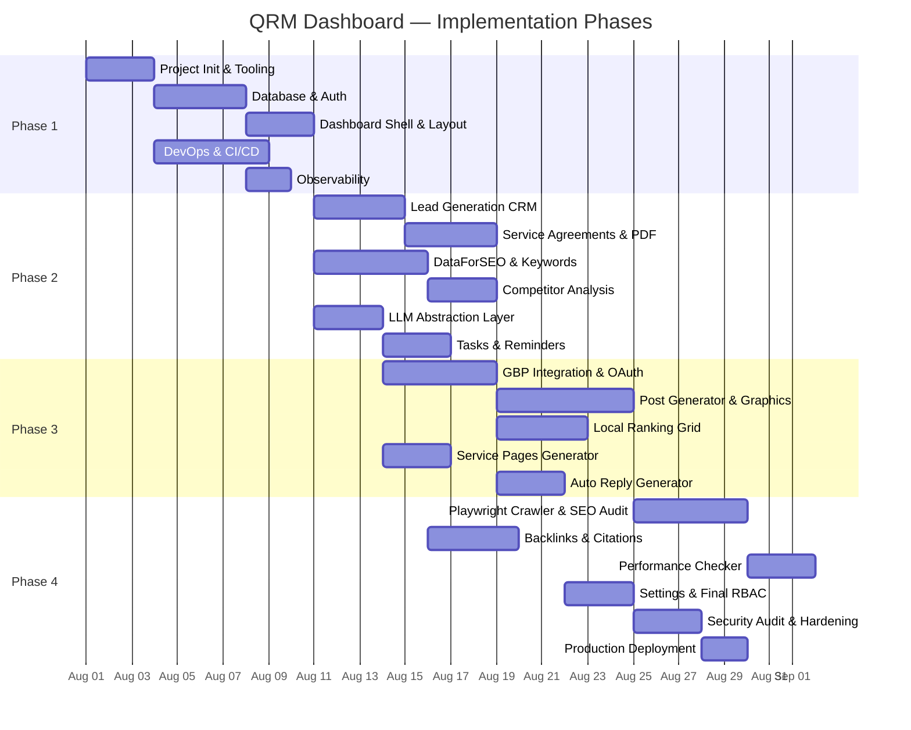
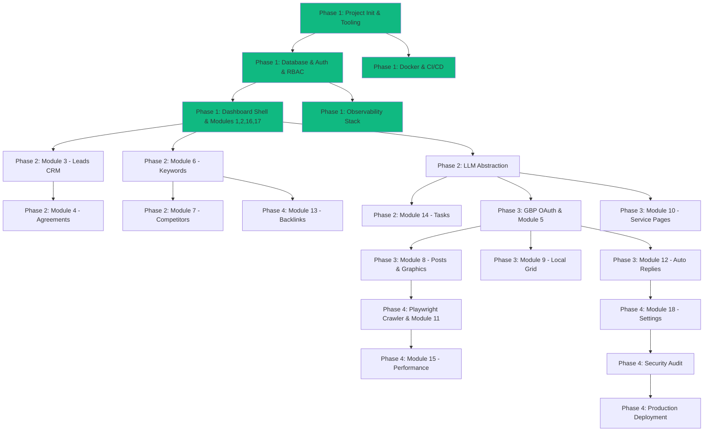

# 📋 Quantum Reach Media — Master Task Breakdown

> **Source**: [implementation_plan.md](file:///C:/Users/Shreyas%20Ambhaikar/Desktop/QRM%20Dashboard/implementation_plan.md)  
> **Review**: [architect_review.md](file:///C:/Users/Shreyas%20Ambhaikar/Desktop/QRM%20Dashboard/architect_review.md)  
> **Last Updated**: 2026-07-29

---

## 🗺️ Phase Overview

---

## 📂 Phase Documents

| Phase | Document | Modules Covered | Estimated Duration |
|---|---|---|---|
| **Phase 1** | [phase-1-foundation.md](file:///C:/Users/Shreyas%20Ambhaikar/Desktop/QRM%20Dashboard/phase-1-foundation.md) | Project Init, Tooling, Auth, RBAC, Database, Docker, CI/CD, Observability, Dashboard Layout, Module 1 (Dashboard Home), Module 2 (Client Mgmt), Module 16 (Notifications), Module 17 (Audit Log) | **~2 weeks** |
| **Phase 2** | [phase-2-core-seo.md](file:///C:/Users/Shreyas%20Ambhaikar/Desktop/QRM%20Dashboard/phase-2-core-seo.md) | Module 3 (Leads), Module 4 (Agreements), Module 6 (Keywords), Module 7 (Competitors), Module 14 (Tasks), LLM Abstraction Layer, R2 Storage Module | **~3 weeks** |
| **Phase 3** | [phase-3-local-seo.md](file:///C:/Users/Shreyas%20Ambhaikar/Desktop/QRM%20Dashboard/phase-3-local-seo.md) | Module 5 (GBP), Module 8 (Posts & Graphics), Module 9 (Local Grid), Module 10 (Service Pages), Module 12 (Auto Replies), Google OAuth Integration | **~3 weeks** |
| **Phase 4** | [phase-4-technical-polish.md](file:///C:/Users/Shreyas%20Ambhaikar/Desktop/QRM%20Dashboard/phase-4-technical-polish.md) | Module 11 (SEO Audit), Module 13 (Backlinks), Module 15 (Performance), Module 18 (Settings), Playwright Crawler, Security Hardening, Production Deployment | **~2 weeks** |

---

## 🔗 Dependency Graph

---

## 📊 Quick-Reference: All 48 Subtasks

### Phase 1 — Foundation, DevOps & RBAC (14 subtasks)
- [ ] 1.1 Initialize Next.js 15+ project with pnpm + Turbopack
- [ ] 1.2 Configure TypeScript strict mode, path aliases, `tsconfig.json`
- [ ] 1.3 Install & configure Tailwind CSS v4 (CSS-first `@theme` config)
- [ ] 1.4 Install shadcn/ui and generate base components (~25 primitives)
- [ ] 1.5 Setup ESLint flat config, Prettier, EditorConfig
- [ ] 1.6 Setup Husky, lint-staged, commitlint (Conventional Commits)
- [ ] 1.7 Create AGENTS.md and `.gemini/rules/*.md` coding rules
- [ ] 1.8 Setup Prisma 6 + full schema + NextAuth models + seed script
- [ ] 1.9 Build NextAuth.js v5 auth (credentials + session) + RBAC middleware
- [ ] 1.10 Build Dashboard Layout (sidebar, topbar, theme switch, notification bell)
- [ ] 1.11 Build Module 1 (Dashboard Home) + Module 2 (Client Management)
- [ ] 1.12 Build Module 16 (Notifications) + Module 17 (Audit Log)
- [ ] 1.13 Setup Docker (Dockerfile, docker-compose, Nginx) + 8 shell scripts
- [ ] 1.14 Setup GitHub Actions CI/CD + Dependabot + Observability (Pino, Sentry, Health Check)

### Phase 2 — Core SEO Workflow & LLM Abstraction (12 subtasks)
- [ ] 2.1 Build LLM Client abstraction (`src/lib/api/llm.ts`) — Groq + Cerebras + Gemini
- [ ] 2.2 Build R2 Storage module (`src/lib/storage/`) — upload, signed URLs, delete
- [ ] 2.3 Build standardized API error contract (`src/lib/api/response.ts`)
- [ ] 2.4 Build Module 3 (Lead Generation) — Kanban board + list view + CRM pipeline
- [ ] 2.5 Build Lead Detail slide-over, lead scoring, quick audit trigger
- [ ] 2.6 Build Lead → Client conversion workflow
- [ ] 2.7 Build Module 4 (Service Agreements) — template editor, PDF gen, email send
- [ ] 2.8 Integrate DataForSEO API client (`src/lib/api/dataforseo.ts`)
- [ ] 2.9 Build Module 6 (Keyword Research) — search, track, bulk import/export
- [ ] 2.10 Build Module 7 (Competitor Analysis) — domain matrix, keyword gap, SoV chart
- [ ] 2.11 Build Module 14 (Daily Tasks) — Kanban board, recurring tasks, client linking
- [ ] 2.12 Build BullMQ email digest worker for daily task summaries

### Phase 3 — Local SEO, GBP & Dual-Mode Graphic Engine (11 subtasks)
- [ ] 3.1 Setup Google Cloud Project (GBP API, Maps API, OAuth consent screen)
- [ ] 3.2 Build Google OAuth integration flow + token refresh logic
- [ ] 3.3 Build Module 5 (GBP Profile Optimization) — profile score, review table
- [ ] 3.4 Build GBP review feed + AI review reply generator (Groq)
- [ ] 3.5 Build Module 8 caption generator (AI text via Groq/Gemini)
- [ ] 3.6 Build Dual-Mode Graphic Engine (Mode A: Ideogram/Imagen, Mode B: Satori/Canvas)
- [ ] 3.7 Build Post Calendar & Queue UI + BullMQ GBP scheduler worker
- [ ] 3.8 Build Module 9 (Local Ranking Grid) — Google Maps JS API + grid overlay
- [ ] 3.9 Build grid snapshot worker + historical comparison + shareable reports
- [ ] 3.10 Build Module 10 (Service Pages Generator) — wizard, AI copy, JSON-LD
- [ ] 3.11 Build Module 12 (Auto Reply Generator) — tone presets, approval workflow

### Phase 4 — Playwright Crawler, Technical Audits & Polish (11 subtasks)
- [ ] 4.1 Build Playwright headless crawler worker (`src/workers/crawler/`)
- [ ] 4.2 Build Module 11 (Website SEO Audit) — health score, issue categorization
- [ ] 4.3 Build branded PDF audit report generator with Playwright screenshots
- [ ] 4.4 Build Module 13 (Backlinks & Citations) — inventory, toxic flagging
- [ ] 4.5 Build CitationListing model + NAP consistency checker
- [ ] 4.6 Build Module 15 (Web Performance Checker) — PageSpeed API + CWV charts
- [ ] 4.7 Build weekly performance cron worker
- [ ] 4.8 Build Module 18 (Settings) — profile, branding, integrations manager
- [ ] 4.9 Build Super Admin RBAC Matrix UI (feature access grid per user)
- [ ] 4.10 Conduct OWASP security audit, CSP verification, rate-limit stress test
- [ ] 4.11 Execute production deployment to Hetzner VPS + verify backups + final smoke test

---

## 📌 Cross-Cutting Concerns (Applied Throughout All Phases)

These are enforced via `AGENTS.md` and `.gemini/rules/*.md` on every subtask:

| Concern | Enforcement |
|---|---|
| **Zod validation** on every Server Action | Backend rule |
| **RBAC permission check** on every Server Action | Backend rule |
| **Pino audit log** on every CREATE/UPDATE/DELETE | Backend rule |
| **shadcn/ui primitives only** (no raw HTML inputs) | Frontend rule |
| **Dark/Light theme support** on every component | Frontend rule |
| **Per-feature `error.tsx`** boundary | Frontend rule |
| **`<Suspense>` with loading skeleton** on heavy data fetches | Frontend rule |
| **Vitest tests** for new utility functions and Server Actions | QA rule |
| **Conventional Commits** on every commit message | Git hook |
