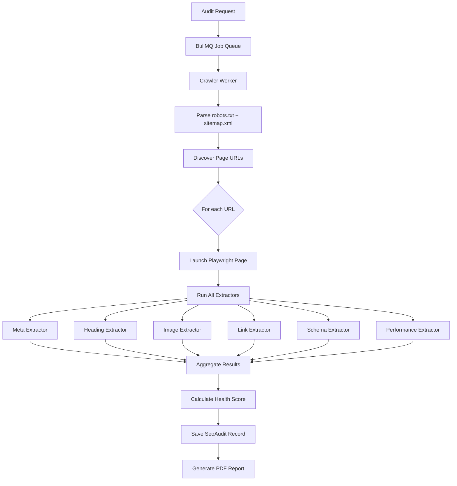

# Phase 4 — Playwright Crawler, Technical Audits & Polish

**Duration**: ~2 weeks (11 subtasks)  
**Prerequisites**: Phases 1-3 complete — all core modules built, GBP integration live, graphic engine functional  
**Outcome**: Full technical SEO audit suite, backlink/citation management, performance monitoring, settings & RBAC matrix, security hardening, and production deployment.

---

## Workstream A: Playwright SEO Crawler (Module 11)

### 4.1 — Build Playwright Headless Crawler Worker

**Goal**: Configurable website crawler that extracts SEO-relevant data using a real browser engine.

**Files**:
```
src/workers/crawler/
├── index.ts                        # Main crawler orchestrator
├── config.ts                       # Crawler configuration (max pages, timeout, viewport)
├── extractors/
│   ├── meta.ts                     # Extract <title>, meta description, canonical, OG tags
│   ├── headings.ts                 # Extract H1-H6 hierarchy and validate structure
│   ├── images.ts                   # Extract  tags, check alt text, check dimensions
│   ├── links.ts                    # Extract all links, check status codes (404/500/301)
│   ├── schema.ts                   # Extract and validate JSON-LD structured data
│   └── performance.ts              # Collect basic timing metrics (DOMContentLoaded, etc.)
├── utils/
│   ├── robots-parser.ts            # Parse robots.txt to respect crawl directives
│   ├── sitemap-parser.ts           # Parse XML sitemaps to discover pages
│   └── url-utils.ts                # URL normalization, deduplication, domain matching
└── types.ts                        # TypeScript types for crawl results
```

**Crawler Architecture**:


**Configuration** (`config.ts`):
```typescript
export const CRAWLER_CONFIG = {
  maxPages: 50,              // Max pages to crawl per audit
  timeout: 30_000,           // 30 second page timeout
  concurrency: 3,            // 3 pages in parallel
  viewports: [
    { name: 'desktop', width: 1920, height: 1080 },
    { name: 'mobile', width: 375, height: 812 },
  ],
  respectRobotsTxt: true,
  screenshotOnError: true,   // Capture screenshot on 4xx/5xx pages
};
```

**Packages**:
```bash
pnpm add playwright-core
```

> [!NOTE]
> We use `playwright-core` (not `playwright`) to avoid bundling browsers. The Playwright Docker container (`docker/Dockerfile.worker`) will have Chromium pre-installed.

**Acceptance Criteria**:
- [x] Crawler respects `robots.txt` directives
- [x] Crawler discovers pages from sitemap.xml
- [x] Each extractor returns typed results matching `types.ts`
- [x] Broken links (404/500) are correctly flagged
- [x] Screenshots are captured for both desktop and mobile viewports
- [x] Crawler completes within 5 minutes for a 50-page site

---

### 4.2 — Build Module 11 (Website SEO Audit)

**Goal**: Full SEO audit dashboard with health scoring and issue categorization.

**Files**:
```
src/app/(dashboard)/seo-audit/
├── page.tsx                        # Audit list + trigger new audit
├── [id]/page.tsx                   # Audit detail with issue breakdown
├── loading.tsx
└── error.tsx

src/features/seo-audit/
├── actions.ts                      # Server Actions (trigger audit, get results, delete)
├── schemas.ts
├── scoring.ts                      # Health score calculation algorithm
└── components/
    ├── audit-trigger-form.tsx      # Enter URL + config + start audit
    ├── audit-progress.tsx          # Real-time crawl progress (pages crawled / total)
    ├── audit-summary.tsx           # Health score gauge + quick stats
    ├── issue-breakdown.tsx         # Categorized issues (Errors / Warnings / Notices)
    ├── issue-detail-modal.tsx      # Detailed explanation + fix recommendation
    ├── page-analysis-table.tsx     # Per-page results table
    ├── cwv-scores.tsx              # Core Web Vitals display (from PageSpeed API)
    └── screenshot-gallery.tsx      # Desktop/mobile screenshot previews
```

**Health Score Algorithm** (`scoring.ts`):
```
Base Score = 100

Deductions:
  - Missing <title>:                           -10 per page
  - Missing meta description:                  -5 per page
  - Duplicate <title> across pages:            -8
  - Missing H1:                                -8 per page
  - Multiple H1s on same page:                 -3 per page
  - Broken link (404):                         -5 per link
  - Server error (500):                        -10 per link
  - Missing alt text on images:                -2 per image (max -20)
  - Missing canonical URL:                     -5 per page
  - Missing JSON-LD schema:                    -3
  - LCP > 4s:                                  -10
  - CLS > 0.25:                                -8
  - INP > 500ms:                               -8

Floor = 0 (minimum score)
```

**PageSpeed Integration**: Call Google PageSpeed Insights API for the root URL to get real LCP, CLS, and INP scores.

**Acceptance Criteria**:
- [x] New audit can be triggered for any client domain
- [x] Progress indicator shows crawl status in real-time
- [x] Health score calculates correctly based on findings
- [x] Issues are categorized as Errors (red), Warnings (yellow), Notices (blue)
- [x] Each issue has a fix recommendation
- [x] Core Web Vitals display from PageSpeed API

---

### 4.3 — Build Branded PDF Audit Report Generator

**Goal**: Generate professional PDF audit reports for client delivery.

**Files**:
```
src/features/seo-audit/pdf/
├── audit-report-template.tsx       # @react-pdf/renderer template
├── generate-audit-pdf.ts           # Server-side generation + R2 upload
└── components/
    ├── pdf-cover-page.tsx          # Branded cover with client name + agency logo
    ├── pdf-score-section.tsx       # Health score gauge + breakdown
    ├── pdf-issues-section.tsx      # Categorized issue tables
    ├── pdf-cwv-section.tsx         # Core Web Vitals summary
    └── pdf-screenshots-section.tsx # Embedded desktop/mobile screenshots
```

**Features**:
- Agency branding (logo, colors from Settings)
- Client name, domain, and audit date
- Health score gauge visualization
- Issue breakdown tables
- CWV scores with pass/fail indicators
- Full-page screenshots (embedded from R2)
- "Powered by Quantum Reach Media" footer

**Acceptance Criteria**:
- [x] PDF generates with all sections populated
- [x] Screenshots are properly embedded from R2 storage
- [x] PDF uploads to R2 and stores URL in `SeoAudit.reportPdfUrl`
- [x] PDF can be sent to client via email (Resend)

---

## Workstream B: Backlinks & Citations (Module 13)

### 4.4 — Build Backlinks Module

**Goal**: Track client backlink profiles with toxic link detection.

**Files**:
```
src/app/(dashboard)/backlinks/
├── page.tsx
├── loading.tsx
└── error.tsx

src/features/backlinks/
├── actions.ts                      # Server Actions (fetch from DataForSEO, CRUD, bulk analyze)
├── schemas.ts
└── components/
    ├── backlink-table.tsx          # Full backlink inventory (TanStack Table)
    ├── backlink-summary.tsx        # Total referring domains, DA distribution chart
    ├── toxic-link-alert.tsx        # Highlighted toxic/spammy domains
    └── backlink-trend-chart.tsx    # New/lost backlinks over time (Recharts)
```

**Data Source**: DataForSEO Backlinks API — fetch referring domains, anchor text, DA scores.

**Toxic Link Detection** (heuristic-based):
```
isToxic = true IF:
  - Domain Authority < 5
  - Referring domain has > 10,000 outbound links (link farm)
  - Anchor text is exact-match commercial keyword (manipulative)
  - Domain is on known spam domain list
```

**Acceptance Criteria**:
- [x] Backlink inventory displays referring domains, anchor text, target URL, DA
- [x] Toxic links are automatically flagged with warning badges
- [x] Summary shows total referring domains and DA distribution
- [x] Backlink data refreshes from DataForSEO on demand

---

### 4.5 — Build CitationListing Model + NAP Consistency Checker

**Goal**: Monitor business listing consistency across local directories.

> [!IMPORTANT]
> **Architect Gap Fix**: The original plan mentioned NAP consistency checking but had no database model for it.

**New Prisma Model**:
```prisma
model CitationListing {
  id              String   @id @default(cuid())
  clientId        String
  directoryName   String   // e.g., "Yelp", "Bing Places", "Apple Maps"
  listingUrl      String?
  nameMatch       Boolean  @default(false)
  addressMatch    Boolean  @default(false)
  phoneMatch      Boolean  @default(false)
  status          String   @default("NOT_CHECKED") // NOT_CHECKED, CONSISTENT, INCONSISTENT, NOT_FOUND
  lastCheckedAt   DateTime?
  client          Client   @relation(fields: [clientId], references: [id], onDelete: Cascade)
  @@unique([clientId, directoryName])
}
```

**Files**:
```
src/features/backlinks/components/
├── citation-checklist.tsx          # Directory listing status table
├── nap-comparison-modal.tsx        # Side-by-side NAP comparison
└── citation-submit-tracker.tsx     # Track manual directory submissions
```

**Directories to Check**: Yelp, Bing Places, Apple Maps, Google Maps, Facebook, Yellow Pages, BBB, Foursquare, Manta, Hotfrog, Jasmine Directory

**Acceptance Criteria**:
- [x] Citation checklist shows status for each major directory
- [x] NAP comparison highlights mismatches in red
- [x] Manual submission tracking with completion checkboxes
- [x] Bulk "Re-check All" button refreshes citation status

---

## Workstream C: Performance Monitoring (Module 15)

### 4.6 — Build Web Performance Checker

**Goal**: Track Core Web Vitals over time with actionable optimization recommendations.

**Files**:
```
src/app/(dashboard)/performance/
├── page.tsx
├── loading.tsx
└── error.tsx

src/features/performance/
├── actions.ts                      # Server Actions (check performance, get history)
├── schemas.ts
└── components/
    ├── performance-dashboard.tsx    # CWV overview cards + trend chart
    ├── cwv-trend-chart.tsx         # LCP/INP/CLS line chart over 6 months (Recharts)
    ├── performance-grade.tsx        # Letter grade (A-F) with color coding
    ├── opportunity-list.tsx        # Lighthouse recommendations list
    └── performance-check-button.tsx # Manual "Run Check" trigger
```

**Data Source**: Google PageSpeed Insights API (free, no API key needed for basic usage)

**Performance Grade Mapping**:
| Score Range | Grade | Color |
|---|---|---|
| 90-100 | A | Green |
| 70-89 | B | Lime |
| 50-69 | C | Yellow |
| 30-49 | D | Orange |
| 0-29 | F | Red |

**Acceptance Criteria**:
- [x] CWV scores fetch from PageSpeed API for both mobile and desktop
- [x] Trend chart shows historical data from `PerformanceLog` table
- [x] Grade letter displays with appropriate color coding
- [x] Optimization recommendations list from Lighthouse audit

---

### 4.7 — Build Weekly Performance Cron Worker

**Goal**: Automated weekly performance checks for all active clients.

**Files**:
```
src/workers/rank-tracker.worker.ts   # Also handles weekly performance checks
```

**Schedule**: BullMQ repeatable job every Sunday at 02:00 AM

**Flow**:
1. Query all active clients
2. For each client with a domain, call PageSpeed Insights API
3. Store LCP, INP, CLS, and performance grade in `PerformanceLog`
4. If grade drops below C (score < 50), create Super Admin notification

**Acceptance Criteria**:
- [x] Worker runs weekly and creates `PerformanceLog` records
- [x] Declining performance triggers notifications
- [x] Historical data accumulates for 6-month trend view

---

## Workstream D: Settings & RBAC Matrix (Module 18)

### 4.8 — Build Settings Module (Profile, Branding, Integrations)

**Goal**: Central configuration hub for the agency dashboard.

**Files**:
```
src/app/(dashboard)/settings/
├── page.tsx                        # Settings overview (tab navigation)
├── profile/page.tsx                # Agency profile & branding
├── team/page.tsx                   # Team management & RBAC matrix
├── integrations/page.tsx           # API key management
├── appearance/page.tsx             # Theme settings
├── loading.tsx
└── error.tsx

src/features/settings/
├── actions.ts                      # Server Actions (update profile, manage team, test integrations)
├── schemas.ts
└── components/
    ├── agency-profile-form.tsx     # Name, logo, contact info, report colors
    ├── integration-card.tsx        # Per-integration status card (connected/disconnected)
    ├── integration-key-form.tsx    # Encrypted API key input + test button
    ├── appearance-selector.tsx     # Light / Dark / System theme toggle
    └── danger-zone.tsx             # Delete account, export all data
```

**Integrations Manager**:
- Google (OAuth status + reconnect)
- DataForSEO (API key + balance check)
- Resend (API key + test email send)
- Groq / Cerebras / Gemini (API keys + test prompt)
- Ideogram / FLUX (optional API keys)

**All API keys stored encrypted** via `src/lib/crypto.ts` (AES-256-GCM)

**Acceptance Criteria**:
- [x] Agency profile updates (name, logo, colors) reflect across the dashboard
- [x] API keys are encrypted before storage, decrypted only for API calls
- [x] "Test Connection" button validates each integration
- [x] Theme selection persists across sessions

---

### 4.9 — Build Super Admin RBAC Matrix UI

**Goal**: Visual permission grid where Super Admin can customize feature access per user.

**Files**:
```
src/features/settings/components/
├── team-table.tsx                  # Team members list with role badges
├── invite-user-modal.tsx           # Invite new team member via email
├── rbac-matrix.tsx                 # 18-module × user permission grid
├── rbac-matrix-row.tsx             # Single user row with toggle dropdowns
└── rbac-matrix-header.tsx          # Column headers for each module
```

**RBAC Matrix UI**:
```
                    | Dashboard | Clients | Leads | Agreements | GBP | Keywords | ...
─────────────────────────────────────────────────────────────────────────────────
John (Admin)        |  [full▾]  | [full▾] |[full▾]|  [full▾]  |[full▾]| [full▾] | ...
Sarah (Specialist)  |  [read▾]  | [read▾] |[none▾]|  [none▾]  |[full▾]| [full▾] | ...
Mike (Writer)       |  [read▾]  | [read▾] |[none▾]|  [none▾]  |[none▾]| [none▾] | ...
```

Each cell is a dropdown: `full` | `read` | `none`

**Features**:
- Changes save immediately (optimistic update + Server Action)
- "Reset to Role Default" button per user
- Tooltips explaining each permission level
- Super Admin row is locked to `full` everywhere (cannot be modified)

**Acceptance Criteria**:
- [x] Matrix displays all team members × all 18 modules
- [x] Changing a permission immediately updates `UserPermission` record
- [x] Sidebar navigation responds in real-time (hides modules set to `none`)
- [x] Server Actions reject unauthorized access for modified permissions
- [x] Super Admin cannot have their own permissions reduced

---

## Workstream E: Security Audit & Production Deployment

### 4.10 — OWASP Security Audit & Hardening

**Goal**: Comprehensive security review and final hardening pass.

**Checklist**:
```
[ ] 1. CSP Headers: Verify nonce-based CSP is active on all pages
[ ] 2. XSS: Test DOMPurify sanitization on all rich-text inputs (Tiptap)
[ ] 3. CSRF: Verify origin checking on all Server Actions
[ ] 4. SQL Injection: Confirm zero raw SQL queries (grep for $queryRaw)
[ ] 5. Rate Limiting: Stress test Redis rate limiter (100 req/min general, 20/min auth)
[ ] 6. Auth: Verify session rotation on login, secure cookie attributes
[ ] 7. RBAC: Test every Server Action with unauthorized roles (expect 403)
[ ] 8. File Upload: Test R2 upload with oversized files, invalid MIME types
[ ] 9. API Keys: Verify all stored keys are encrypted (grep for plaintext patterns)
[ ] 10. HTTP Headers: Verify HSTS, X-Content-Type-Options, X-Frame-Options
[ ] 11. Docker: Confirm non-root execution, network isolation
[ ] 12. Dependencies: Run `pnpm audit --audit-level=high` (zero high/critical)
[ ] 13. Environment: Verify .env.local is in .gitignore, no secrets in git history
[ ] 14. CORS: Verify no wildcard `*` in allowed origins
[ ] 15. Logging: Verify Pino doesn't log sensitive data (passwords, tokens, API keys)
```

**Acceptance Criteria**:
- [x] All 15 security checks pass
- [x] Zero high or critical vulnerability in dependency audit
- [x] Rate limiter correctly blocks excessive requests
- [x] RBAC blocks unauthorized Server Action calls with 403

---

### 4.11 — Production Deployment & Final Verification

**Goal**: Deploy to Hetzner VPS and verify everything works in production.

**Deployment Steps**:
1. **Provision VPS**: Run `scripts/setup-server.sh` on fresh Hetzner CPX21
2. **DNS Setup**: Point `app.quantumreachmedia.com` (or chosen subdomain) to VPS IP via Cloudflare DNS
3. **SSL Setup**: Run `scripts/ssl-setup.sh` to provision Let's Encrypt certificate
4. **Environment**: Run `scripts/generate-env.sh` to create production `.env.production`
5. **Initial Deploy**: Run `scripts/deploy.sh`:
   - Clone repository
   - Build Docker images
   - Run database migrations (`prisma migrate deploy`)
   - Start all 6 containers via `docker-compose.yml`
   - Verify health check (`curl /api/health`)
6. **Seed Production**: Create Super Admin account via `scripts/seed-db.sh` (production mode — only Super Admin, no sample data)
7. **Configure Backups**: Add `scripts/backup-db.sh` to cron (`0 3 * * *` — daily at 3 AM)
8. **UptimeRobot**: Configure monitor for `https://app.quantumreachmedia.com/api/health`
9. **Sentry**: Verify error reporting with a test exception

**Smoke Test Checklist**:
```
[ ] 1. HTTPS redirect works (HTTP → HTTPS)
[ ] 2. Login page loads with correct branding
[ ] 3. Super Admin can log in
[ ] 4. Dashboard home shows KPI cards
[ ] 5. Client CRUD works
[ ] 6. GBP OAuth connect flow works
[ ] 7. Post graphic generator produces correct output
[ ] 8. BullMQ worker processes a scheduled job
[ ] 9. Notification bell shows alerts
[ ] 10. Audit log records all actions
[ ] 11. `/api/health` returns 200 with DB + Redis status
[ ] 12. Nginx rate limiting blocks excessive requests
[ ] 13. Database backup creates valid dump file
[ ] 14. Zero-downtime deploy works (deploy while app is running)
```

**Acceptance Criteria**:
- [x] Application is live at `https://app.quantumreachmedia.com`
- [x] All 14 smoke test items pass
- [x] Daily database backups are running
- [x] UptimeRobot is monitoring and alerting
- [x] Sentry is capturing errors with source maps
- [x] CI/CD pipeline deploys automatically on push to `main`

---

## 🏁 Post-Launch Priorities (Future Phases)

Once Phase 4 is complete and the dashboard is live, these items are queued for future development:

| Priority | Feature | Notes |
|---|---|---|
| 🔴 High | **No-Code Website Builder** | Excluded from current scope per user request |
| 🔴 High | **Billing & Stripe Integration** | Excluded from current scope per user request |
| 🟡 Medium | **Google Search Console Integration** | GSC API client stub created in Phase 3 |
| 🟡 Medium | **White-Label Reports** | Client-facing branded PDF reports with agency theming |
| 🟡 Medium | **E2E Tests with Playwright** | Full user flow automation (login, CRUD, scheduling) |
| 🟢 Low | **PWA Support** | Offline access, push notifications |
| 🟢 Low | **Multi-Language Support** | i18n for international agencies |
