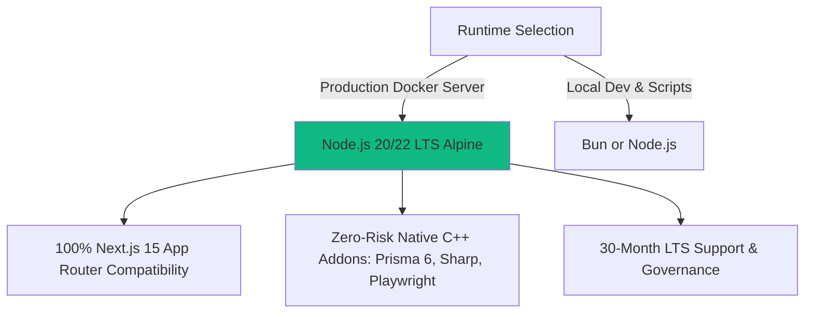
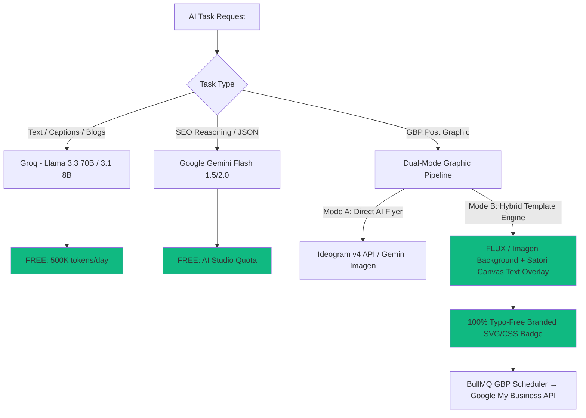

# Quantum Reach Media — SEO Agency Dashboard (v6 — Complete Master Plan)

A production-grade, self-hosted SEO agency dashboard with enterprise-level tooling, containerization, real-time notifications, granular RBAC, AI content & graphic generation, and full observability — running on a single VPS for under $30/month.

---

## 📚 Version History & Evolution

| Version | Highlights |
|---|---|
| **v1 (Initial Plan)** | Foundational 15-module agency dashboard, self-hosted PostgreSQL/Redis, Next.js App Router architecture. |
| **v2 (Cost-Optimized)** | Replaced all expensive SaaS tools with free/OSS alternatives, added Pino logging, Sentry error tracking, UptimeRobot, full database schema, and detailed cost breakdown (~$20/month). |
| **v3 (DevOps & Tooling)** | Added Multi-Stage Dockerfile, Docker Compose, 8 automation shell scripts (`scripts/*.sh`), Playwright headless SEO crawler, 26 security best practices, Husky/commitlint/lint-staged, and a 42-row service classification table. |
| **v4 (RBAC & AI Strategy)** | Added Real-Time Notification System (Super Admin alerts), Granular RBAC Feature Permission Matrix, 6 AI Development Agents, 3 coding rule files (`AGENTS.md`, `.gemini/rules/*.md`), 12-provider LLM API comparison ($0/mo core), and Year 1 cost projection. |
| **v5 (Runtime & Graphics)** | Recommended Node.js 20/22 LTS + Turbopack over Bun/Webpack for production; designed Dual-Mode GBP Graphic Engine (Ideogram / Imagen / FLUX + Hybrid Satori/HTML5 Canvas Template Engine) and automated BullMQ GBP scheduling pipeline. |
| **v6 (Complete Master)** | **Current Definitive Document** — Retains and restores 100% of the unabridged module specifications, database models, schemas, and layouts from v1/v2, integrated seamlessly with all v3–v5 technical additions. Nothing omitted. |

---

## ⚡ JavaScript Runtime & Bundler Architecture



### 1. Why Node.js 20/22 LTS over Bun for Production Docker?
We recommend **Node.js 20/22 LTS (Alpine)** for production containerization with **pnpm** as our package manager:
- **100% App Router & Server Action Compatibility**: Next.js 15/16 streaming, React Server Components (RSC), and Server Actions are built and tested natively against Node.js.
- **Zero-Risk Native C++ Modules**: Our application relies on **Prisma 6** (C++ query engine), **sharp** (native C image processing), and **Playwright** (Chromium child processes). Node.js Alpine/Slim guarantees zero N-API edge-case crashes or memory leaks under high concurrency.
- **LTS Guarantee**: 30-month long-term support with OpenJS Foundation governance.
- *Local Development*: Developers can still use `bun run` locally for `<10ms` script execution, but Docker production uses Node.js LTS.

### 2. Why Turbopack over Legacy Webpack?
We recommend **Turbopack** (`next dev --turbopack` and default production builder in Next.js 16+):
- **Rust-Powered (SWC)**: Eliminates Node.js memory ceilings and garbage collection pauses.
- **8x Faster Cold Starts**: Dev server boots in **~0.8 seconds** vs. ~6.5+ seconds on Webpack.
- **<50ms Fast Refresh (HMR)**: Instant UI updates when tweaking charts, data tables, and editors.
- **Incremental Computation Graph**: Scales effortlessly across all 18 agency dashboard modules.

---

## 📊 Complete Service Classification: Free Forever vs Free Tier vs Paid

### 🟢 Completely Free (Forever, No Limits That Matter)

| # | Service | Category | Cost | Duration | Notes |
|---|---|---|---|---|---|
| 1 | **Next.js 15+ / 16** | Framework | $0 | Forever | OSS, MIT license |
| 2 | **Node.js 20/22 LTS** | Runtime | $0 | Forever | **Recommended production Docker runtime** |
| 3 | **Turbopack** | Bundler | $0 | Forever | **Default Rust-based bundler** |
| 4 | **React 19** | UI Library | $0 | Forever | OSS, MIT license |
| 5 | **TypeScript 5.5+** | Language | $0 | Forever | OSS |
| 6 | **Tailwind CSS v4** | Styling | $0 | Forever | OSS, MIT license |
| 7 | **shadcn/ui** | Components | $0 | Forever | OSS, copy-paste model (no dependency) |
| 8 | **Lucide React** | Icons | $0 | Forever | OSS, ISC license |
| 9 | **Framer Motion** | Animations | $0 | Forever | OSS, MIT license |
| 10 | **Recharts** | Charts | $0 | Forever | OSS, MIT license |
| 11 | **TanStack Table** | Data Tables | $0 | Forever | OSS, MIT license |
| 12 | **TanStack Query** | Data Fetching | $0 | Forever | OSS, MIT license |
| 13 | **Zustand** | State | $0 | Forever | OSS, MIT license |
| 14 | **PostgreSQL 16** | Database | $0 | Forever | OSS, self-hosted in Docker |
| 15 | **Redis 7** | Cache/Queue | $0 | Forever | OSS, self-hosted in Docker |
| 16 | **Prisma 6** | ORM | $0 | Forever | OSS, Apache 2.0 |
| 17 | **NextAuth.js v5** | Auth | $0 | Forever | OSS, ISC license |
| 18 | **BullMQ** | Job Queue | $0 | Forever | OSS, MIT license (uses self-hosted Redis) |
| 19 | **Pino** | Logging | $0 | Forever | OSS, MIT license |
| 20 | **React Hook Form** | Forms | $0 | Forever | OSS, MIT license |
| 21 | **Zod** | Validation | $0 | Forever | OSS, MIT license |
| 22 | **Tiptap** | Rich Text Editor | $0 | Forever | OSS core (MIT); paid for collaboration features |
| 23 | **@react-pdf/renderer** | PDF Gen | $0 | Forever | OSS, MIT license |
| 24 | **Playwright** | Web Scraping | $0 | Forever | OSS, Apache 2.0 |
| 25 | **Docker** | Containers | $0 | Forever | OSS, Apache 2.0 |
| 26 | **Nginx** | Reverse Proxy | $0 | Forever | OSS |
| 27 | **Let's Encrypt** | SSL | $0 | Forever | Free, auto-renewable |
| 28 | **Coolify** | Deployment PaaS | $0 | Forever | OSS, self-hosted (Apache 2.0) |
| 29 | **Husky** | Git Hooks | $0 | Forever | OSS, MIT license |
| 30 | **ESLint + Prettier** | Linting | $0 | Forever | OSS |
| 31 | **PM2** | Process Mgr | $0 | Forever | OSS (AGPLv3) |
| 32 | **date-fns** | Date Utilities | $0 | Forever | OSS, MIT license |
| 33 | **React Email** | Email Templates | $0 | Forever | OSS, MIT license |
| 34 | **bcrypt** | Password Hashing | $0 | Forever | OSS |
| 35 | **Satori / HTML5 Canvas**| Graphic Overlay | $0 | Forever | **Built-in template engine for GBP posts** |

### 🟡 Free Tier (Permanent Free Plan with Limits)

| # | Service | Free Tier Limits | Duration | Enough for Us? | Paid Upgrade Cost |
|---|---|---|---|---|---|
| 36 | **Groq API** (LLM Text) | 500K tokens/day, Llama 3.3 70B | **Permanent** | ✅ Yes (All captions & blogs) | Pay-as-you-go ($0.59/1M) |
| 37 | **Cerebras** (LLM Text) | 1,000,000 tokens/day | **Permanent** | ✅ Yes (Bulk SEO analysis) | Pay-as-you-go |
| 38 | **Google Gemini** (AI Studio)| Rate-limited free tier + Imagen | **Permanent** | ✅ Yes (~20 free images/day) | Flash: ~$0.075/1M; Imagen: $0.02/img |
| 39 | **Resend** (email API) | 100 emails/day, 3,000/month | **Permanent** | ✅ Yes (~50-100 emails/month) | $20/month → 50K emails/month |
| 40 | **Sentry** (error tracking)| 5,000 error events/month, 1 user | **Permanent** | ✅ Yes (~500-1K errors/month)| $26/month → 50K events |
| 41 | **UptimeRobot** (uptime) | 50 monitors, 5-min check intervals| **Permanent** | ✅ Yes (1 monitor needed) | $7/month → 1-min intervals |
| 42 | **Cloudflare** (DNS + CDN)| Unlimited DNS, DDoS, free SSL | **Permanent** | ✅ Yes | $20/month → WAF |
| 43 | **Cloudflare R2** (storage)| 10GB storage, 1M writes/mo, $0 egress| **Permanent** | ✅ Yes (PDF reports, media) | $0.015/GB-month beyond 10GB |
| 44 | **Google Maps JS API** | 10,000 map loads/month (Essentials)| **Permanent** | ✅ Yes (local grid feature) | $7/1K loads beyond free quota |
| 45 | **Google APIs** (GBP, GSC)| Generous daily quotas (10K-25K/day) | **Permanent** | ✅ Yes | N/A (quota increases) |

### 🔴 Paid (Cannot Avoid or Highly Recommended for Polish)

| # | Service | Cost | Billing Model | Notes |
|---|---|---|---|---|
| 46 | **Hetzner VPS** (CPX21) | **~€8/month (~$9)** | Monthly fixed | 4GB RAM, 3 vCPU, 80GB SSD. Runs everything. |
| 47 | **DataForSEO API** | **~$10-15/month** | Pay-as-you-go | $50 one-time min deposit (lasts 3-6 months). |
| 48 | **Domain Name** | **~$10-15/year (~$1/month)**| Annual | Via Cloudflare Registrar or Namecheap |
| 49 | **Ideogram API / FLUX** *(Optional)*| **~$0.003 - $0.02/image**| Pay-as-you-go | Only if exceeding Gemini's free image quota. |

### 💰 Year 1 Complete Cost Summary

| Cost Category | Minimum | Typical | Maximum |
|---|---|---|---|
| **One-Time Setup** (DataForSEO deposit + domain + 1st month VPS) | $71 | $71 | $71 |
| **Monthly Recurring** (VPS $9 + DataForSEO ~$10-15 + Domain ~$1) | $15/month | $25/month | $35/month |
| **Year 1 Total Cost** | **$251** | **$371** | **$491** |

> [!TIP]
> **SaaS Cost Comparison**: A comparable external SaaS stack (Semrush $130/mo + BrightLocal $39/mo + AgencyAnalytics $79/mo) costs **~$2,976/year**. Our self-hosted solution saves **85–90% ($2,600+/year)** while maintaining complete data ownership.

---

## 🧠 AI LLM & GBP Marketing Graphic Generation Strategy



### 1. Dual-Mode GBP Graphic & Post Pipeline (Module 8 & 5)
GBP posts require compelling visual marketing graphics and zero typo risk in phone numbers, discount codes, or URLs.
- **Mode A (Direct AI Flyer — Ideogram v4 / Gemini Imagen)**: For single-prompt promotional flyers where text is baked into the pixels. Ideogram v4 is the industry leader for typography.
- **Mode B (Hybrid Canvas Template Engine — Recommended & Free!)**:
  1. **Clean Background**: AI generates an ultra-clean, photorealistic background photo (via **Gemini Imagen Free Tier** or **FLUX.1 at $0.003/img**), or uses the client's storefront/team photo.
  2. **Canvas/Satori Overlay**: Our dashboard uses an **HTML5 Canvas / Satori (`@vercel/og`)** engine to overlay sharp SVG/CSS promotional typography, client logo, brand primary/secondary colors, discount badge, and call-to-action button.
  3. **0% Typo Rate**: Typography is rendered via CSS font engines, guaranteeing 100% spelling accuracy and brand consistency.

---

## 🔔 Real-Time Notification System

### Architecture
- **Super Admin Alerts**: Real-time notification bell (with unread badge) + Resend email digests sent to the Super Admin for:
  - Any settings or integration modification.
  - User invitation, role override, or deactivation.
  - Client deletion, agreement voiding, or bulk data export.
  - Failed login spikes (3+ attempts) or API key rotations.
  - Major SEO ranking drops (>10 positions) or completed audits.
- **Delivery Channels**: In-app polling/WebSocket + instant Resend transactional email + customizable daily digest (at 09:00 AM via BullMQ worker).

---

## 🛡️ Granular RBAC & Super Admin Feature Permission Matrix

### 1. 6 Hierarchical Roles
- **Super Admin**: Agency owner; full access to all 18 modules, user management, and audit logs. Cannot be deleted.
- **Admin**: Senior agency manager; full feature access and team management (except Super Admin).
- **Manager**: Team lead; can manage clients and oversee SEO workflows.
- **SEO Specialist**: Technical SEO; access to keywords, audits, GBP, backlinks, competitors, tasks, performance.
- **Content Writer**: Content creator; access to posts, service pages, auto-replies, tasks.
- **Viewer**: Read-only stakeholder access.

### 2. Custom Permission Matrix (Super Admin Feature Grid)
In **Settings → Team**, the Super Admin can override default role permissions per user across all 18 feature modules:
```typescript
interface UserPermissions {
  userId: string;
  role: Role;
  customPermissions: {
    dashboard: 'full' | 'read' | 'none';
    clients: 'full' | 'read' | 'none';
    leads: 'full' | 'read' | 'none';
    agreements: 'full' | 'read' | 'none';
    gbp: 'full' | 'read' | 'none';
    keywords: 'full' | 'read' | 'none';
    competitors: 'full' | 'read' | 'none';
    posts: 'full' | 'read' | 'none';
    localGrid: 'full' | 'read' | 'none';
    servicePages: 'full' | 'read' | 'none';
    seoAudit: 'full' | 'read' | 'none';
    autoReplies: 'full' | 'read' | 'none';
    backlinks: 'full' | 'read' | 'none';
    tasks: 'full' | 'read' | 'none';
    performance: 'full' | 'read' | 'none';
    notifications: 'full' | 'read' | 'none';
    activityLog: 'full' | 'read' | 'none';
    settings: 'full' | 'read' | 'none';
  };
}
```
- **Dynamic UI**: If a module is set to `'none'`, its sidebar item disappears.
- **Middleware Enforcement**: Every Server Action validates access via `await withPermission('featureName', 'full')(userId)`.

---

## 🤖 6 Development Agents & Strict Coding Rules

To prevent AI coding agents from drifting from project standards, we include **3 mandatory markdown rule files** that are read before every development task:

1. `AGENTS.md` (Project Root): Enforces feature-first directory structure, Zod schema validation on every mutation, RBAC checks, and Pino audit logging.
2. `.gemini/rules/frontend.md`: Enforces shadcn/ui components, Tailwind CSS variables, dark/light theme compatibility, and WCAG accessibility.
3. `.gemini/rules/backend.md`: Enforces Prisma parameterized queries (zero SQL injection), Redis rate limiting (100 req/min), encrypted API keys, and BullMQ worker retry strategies.

**6 Specialized AI Development Agents**:
- **UI/UX Agent**: Responsive layouts, shadcn/ui primitives, theme support.
- **Backend Agent**: Server Actions, Prisma schemas, external API clients, BullMQ workers.
- **QA Agent**: Vitest unit/integration test suites, RBAC edge-case testing.
- **DevOps Agent**: Multi-stage Dockerfile, Docker Compose, Nginx, Shell Scripts.
- **SEO Domain Agent**: Verifies SEO business logic, GBP API payloads, schema markup.
- **Security Agent**: OWASP Top 10 checks, CSP nonces, rate-limiting audits, encryption.

---

## 🐳 Docker Containerization & 8 Automation Shell Scripts

### 1. Multi-Stage Production Dockerfile (`docker/Dockerfile`)
```dockerfile
# Stage 1: Dependencies
FROM node:20-alpine AS deps
RUN apk add --no-cache libc6-compat
WORKDIR /app
COPY package.json package-lock.json ./
RUN npm ci --omit=dev

# Stage 2: Builder
FROM node:20-alpine AS builder
WORKDIR /app
COPY --from=deps /app/node_modules ./node_modules
COPY . .
ENV NEXT_TELEMETRY_DISABLED=1
RUN npx prisma generate
RUN npm run build

# Stage 3: Minimal Production Runner (~150MB)
FROM node:20-alpine AS runner
WORKDIR /app
ENV NODE_ENV=production NEXT_TELEMETRY_DISABLED=1

# Non-root security user
RUN addgroup --system --gid 1001 nodejs && adduser --system --uid 1001 nextjs
COPY --from=builder /app/public ./public
COPY --from=builder /app/prisma ./prisma
COPY --from=builder --chown=nextjs:nodejs /app/.next/standalone ./
COPY --from=builder --chown=nextjs:nodejs /app/.next/static ./.next/static
RUN npm install sharp

USER nextjs
EXPOSE 3000
ENV PORT=3000 HOSTNAME="0.0.0.0"
CMD ["node", "server.js"]
```

### 2. Production Docker Compose (`docker/docker-compose.yml`)
Orchestrates 6 containers on a custom bridge network (`qrm-network`):
- `app`: Next.js 15 Standalone server (port 3000).
- `postgres`: PostgreSQL 16 Alpine with persistent volume and health check.
- `redis`: Redis 7 Alpine with LRU cache eviction policy.
- `nginx`: Nginx 1.27 Alpine reverse proxy (SSL termination, rate limiting, gzip/brotli).
- `worker`: BullMQ background worker for scheduled GBP posts and email digests.
- `playwright`: Headless Chromium container for on-demand Website SEO Audits.

### 3. 8 Automation Shell Scripts (`scripts/*.sh`)
1. `setup-server.sh`: One-command fresh VPS setup (installs Docker, configures UFW firewall, creates 4GB swap file, hardens SSH).
2. `deploy.sh`: Zero-downtime rolling deployment with automated health check rollback.
3. `backup-db.sh`: Daily gzip PostgreSQL backup via `pg_dump` with automated 30-day rotation.
4. `restore-db.sh`: One-command disaster recovery database restoration.
5. `generate-env.sh`: Interactive environment variable generator.
6. `ssl-setup.sh`: Let's Encrypt Certbot SSL provisioning and automated renewal.
7. `seed-db.sh`: Development database seeding with sample agency clients and leads.
8. `health-check.sh`: 5-minute cron monitor reporting service health to UptimeRobot.

---

## 🕷️ Playwright Headless SEO Audit Crawler (`src/workers/crawler/`)

Playwright drives a real headless browser engine for **Module 11 (Website SEO Audit)**:
- **Meta Tag & Heading Hierarchy**: Crawls client pages to verify `<title>`, meta description, canonical URLs, OG tags, and H1–H6 structural order.
- **Broken Link & Status Audit**: Intercepts network requests to flag 404/500 broken links and redirect chains.
- **Schema Markup Validation**: Extracts and validates JSON-LD structured data blocks.
- **Mobile Rendering & Screenshots**: Emulates desktop and mobile viewports, capturing full-page screenshots for client audit reports.
- **JavaScript Rendering (SSR Check)**: Compares raw HTML vs. client-rendered DOM to detect JavaScript rendering bottlenecks.

---

## 🔒 26 Enterprise Security Best Practices

### Frontend Security
1. **Nonce-Based Content Security Policy (CSP)**: Configured in `next.config.ts`.
2. **XSS Prevention**: React automatic escaping + DOMPurify sanitization for HTML content.
3. **CSRF Protection**: Native origin verification on Server Actions + custom CSRF tokens for APIs.
4. **Secure Auth Cookies**: Strict `httpOnly`, `secure`, and `sameSite: 'lax'` attributes.
5. **No Client Secrets**: Strict separation of server-only vs. `NEXT_PUBLIC_` env vars via `t3-env`.
6. **Subresource Integrity (SRI)**: Hash verification for external assets.
7. **Clickjacking Defense**: `X-Frame-Options: SAMEORIGIN`.

### Backend Security
8. **Zod Input Validation**: 100% of Server Actions validate input payloads before DB access.
9. **SQL Injection Defense**: Prisma ORM parameterized queries exclusively.
10. **Redis Rate Limiting**: 100 req/min general API limit; 20 req/min auth/login limit.
11. **Password Hashing**: `bcrypt` with 12 salt rounds.
12. **JWT Session Security**: Short-lived access tokens with secure rotation.
13. **RBAC Middleware**: Mandatory role and custom permission verification per route.
14. **Tamper-Proof Audit Trail**: All CREATE/UPDATE/DELETE operations recorded in `AuditLog`.
15. **API Key Encryption**: Third-party API keys stored in PostgreSQL encrypted via AES-256-GCM.

### Infrastructure Security
16. **HTTPS Everywhere**: Nginx mandatory HTTP → HTTPS redirect via Let's Encrypt SSL.
17. **HSTS Header**: `Strict-Transport-Security: max-age=31536000; includeSubDomains; preload`.
18. **Hardened HTTP Headers**: `X-Content-Type-Options: nosniff`, `Referrer-Policy: strict-origin-when-cross-origin`.
19. **Non-Root Docker Execution**: App container runs under `uid 1001` (`nextjs`).
20. **Network Isolation**: PostgreSQL and Redis containers exposed only inside `qrm-network`.
21. **UFW Firewall**: Only SSH (22), HTTP (80), and HTTPS (443) open on VPS.
22. **SSH Hardening**: Root login and password authentication disabled; SSH keys required.
23. **Dependency Auditing**: Automated `npm audit --audit-level=high` check in CI.
24. **Environment Isolation**: `.env.local` vs. `.env.production` strict gitignore separation.
25. **Secrets Rotation Policy**: Documented periodic rotation for `NEXTAUTH_SECRET` and DB passwords.
26. **Strict CORS Policy**: Whitelisted domain origins only; no wildcard `*` allowed.

---

## 📈 Logging, Monitoring & Observability

```
               ┌────────────────────────────────────────────────────────┐
               │              APP ROUTER / SERVER ACTIONS               │
               └───────────┬──────────────────────────────┬─────────────┘
                           │ (Structured Logs)            │ (Exceptions)
                           ▼                              ▼
               ┌───────────────────────┐      ┌─────────────────────────┐
               │  PINO LOGGER (JSON)   │      │   SENTRY SDK (FREE)     │
               │  - stdout -> Docker   │      │   - 5,000 errors/month  │
               │  - file -> PM2 / logs │      │   - Source map support  │
               └───────────┬───────────┘      └─────────────────────────┘
                           │
                           ▼
               ┌───────────────────────┐      ┌─────────────────────────┐
               │    AUDIT LOG TABLE    │      │   UPTIMEROBOT (FREE)    │
               │  - Who did what, when │      │   - 5-min health checks │
               │  - Before/after JSON  │      │   - Alerts via Email    │
               └───────────────────────┘      └─────────────────────────┘
```

1. **Structured Application Logging (Pino)**: High-speed JSON logger writing structured logs (`level`, `timestamp`, `userId`, `action`, `metadata`) to Docker stdout and local log files with `logrotate`.
2. **Error Tracking (Sentry Free Tier)**: Captures up to 5,000 monthly error events with full TypeScript source map stack traces.
3. **Uptime & Health Monitoring (UptimeRobot Free Tier)**: Pings `/api/health` every 5 minutes, verifying database and Redis connectivity.
4. **Audit Trail (`AuditLog` table)**: Records every user mutation with before/after JSON diffs for Super Admin oversight.
5. **Performance Tracking**: Captures Core Web Vitals (LCP, INP, CLS) across client landing pages.

---

## 🏗️ Complete Unabridged 18-Module Specifications

### Module 1: Dashboard Home
- **Core Purpose**: Command center overview of agency performance, client health, and daily action items.
- **Key Features**:
  - Top KPI Cards: Total Active Clients, Total Keywords Tracked, Avg Ranking Position, Pending Leads.
  - Ranking Distribution Chart (Recharts): Stacked bar chart showing keywords in Top 3, 4-10, 11-20, 21-50, and 50+.
  - Recent Activity Feed: Live feed from `AuditLog` showing team member actions.
  - Urgent Tasks Widget: Filtered view of tasks due today or overdue.
  - Client Health Indicator: Green/Yellow/Red status dots based on recent ranking trend and GBP health.

### Module 2: Client Management (Hub)
- **Core Purpose**: Centralized database of all agency clients and their connected integrations.
- **Key Features**:
  - Client List View: Searchable, sortable TanStack Table with filters by industry, status, and health.
  - Client Detail Page: Sub-navigation tabs (Overview, Keywords, GBP, Competitors, Backlinks, Notes).
  - Integration Status: Visual badges showing connection status for Google Business Profile, Google Search Console, and DataForSEO.
  - Client Notes & Timeline: Rich text notes (Tiptap) with timestamped milestone history.
  - CSV/JSON Export: Export client data for reporting.

### Module 3: Lead Generation
- **Core Purpose**: CRM pipeline for tracking prospective SEO agency clients from discovery to close.
- **Key Features**:
  - Kanban Board & List View: Columns for `NEW`, `CONTACTED`, `AUDIT_SENT`, `PROPOSAL`, `WON`, `LOST`.
  - Lead Scoring: Automated score (0-100) based on website presence, GBP review count, and estimated budget.
  - Quick Audit Trigger: One-click mini SEO audit generation for prospective leads.
  - Lead Detail Slide-over: Manage contact info, notes, audit results, and assigned team member.
  - Conversion Workflow: One-click "Convert to Client" action that transfers lead data into a new Client profile.

### Module 4: Service Agreements
- **Core Purpose**: Create, send, and track SEO agency service contracts and monthly deliverables.
- **Key Features**:
  - Agreement Template Editor: Markdown/Rich-text editor with placeholders (`{{client_name}}`, `{{monthly_fee}}`, `{{start_date}}`).
  - PDF Generation (`@react-pdf/renderer`): Generate clean, branded PDF contracts on the server.
  - Agreement Tracking Table: Status tracking (`DRAFT`, `SENT`, `SIGNED`, `EXPIRED`, `CANCELLED`).
  - Deliverable Checklists: Monthly itemized deliverables linked to each agreement.
  - Email Sending: Send PDF agreement attachments directly via Resend email API.

### Module 5: Google Business Profile (GBP) Profile Optimization
- **Core Purpose**: Monitor, optimize, and score local Google Business Profile listings.
- **Key Features**:
  - GBP Integration: Connect via Google My Business API (OAuth 2.0).
  - Profile Completeness Score: 100-point audit grading Name, Category, Hours, Attributes, Photos, and Description.
  - Review Management Table: View all incoming GBP reviews, filter by rating, and track reply status.
  - AI Review Reply Generator: Generate thoughtful, personalized responses using Groq (Llama 3.3 70B) with tone presets.
  - GBP Post History: View previously published GBP updates, offers, and events.

### Module 6: Keyword Research
- **Core Purpose**: Research, track, and categorize search terms for client SEO campaigns.
- **Key Features**:
  - Keyword Search Interface: Query DataForSEO API for search volume, CPC, keyword difficulty (KD), and search intent.
  - AI Search Intent Tagging: Automatically classify keywords as `Informational`, `Navigational`, `Commercial`, or `Transactional`.
  - Keyword Tracker Table: Track client keywords with historical position ranking charts.
  - Bulk Import/Export: Add keywords via CSV upload or export tracked data.
  - SERP Feature Indicators: Tag keywords that trigger Local Pack, Featured Snippet, or People Also Ask.

### Module 7: Competitor Analysis
- **Core Purpose**: Track and compare client domain performance against top SERP competitors.
- **Key Features**:
  - Domain Comparison Matrix: Head-to-head comparison of Domain Authority, total backlinks, and estimated organic traffic.
  - Keyword Gap Analysis: Identify valuable keywords competitors rank for where the client does not.
  - Competitor Ranking Tracker: Track up to 5 competitor URLs alongside client keywords.
  - Share of Voice (SoV) Chart: Pie chart visualizing market share across tracked keyword sets.

### Module 8: Post Generator & Scheduler (with Dual-Mode Graphic Engine)
- **Core Purpose**: Generate AI captions, create branded promotional graphics, and schedule automated GBP posts.
- **Key Features**:
  - AI Caption Generator: Use Groq (Llama 3.3 70B) to generate promotional, educational, or offer posts optimized for local SEO.
  - **Dual-Mode Graphic Generator**:
    - *Mode A*: Direct promotional flyer generation via Ideogram v4 API or Gemini Imagen.
    - *Mode B (Recommended)*: AI background photo (Gemini Imagen free tier / FLUX) + **Satori/HTML5 Canvas Template Engine** overlaying sharp, 100% typo-free SVG/CSS promotional typography, client logo, and CTA badge.
  - Post Calendar & Queue: Interactive monthly calendar view showing scheduled, published, and draft posts.
  - Automated Publishing: BullMQ background worker automatically publishes posts to GBP via API at the scheduled timestamp.

### Module 9: Local Ranking Grid
- **Core Purpose**: Visualize client local search ranking visibility across a geographic coordinate grid.
- **Key Features**:
  - Interactive Grid Overlay: Google Maps JavaScript API (Dynamic Maps) with a customizable 3x3, 5x5, or 7x7 grid overlay.
  - Pinpoint Rank Display: Colored circle markers at each coordinate showing exact local ranking position (1 = Green, 4 = Yellow, 10+ = Red).
  - Radius & Distance Selector: Set grid spacing from 0.5 miles to 5 miles.
  - Historical Snapshot Comparison: Compare grid rankings month-over-month to demonstrate local SEO campaign progress.
  - Shareable Grid Report: Export clean grid map images for client reporting.

### Module 10: Service Pages Content Generator
- **Core Purpose**: Generate localized SEO service landing page copy and structured JSON-LD schema markup.
- **Key Features**:
  - Page Builder Wizard: Input service name, target city/region, primary keyword, and client benefits.
  - AI Content Generation: Generate full-length (1,200+ words) HTML landing page copy with H1–H3 structure and FAQs.
  - JSON-LD Schema Generator: Automatically generate valid `LocalBusiness` and `Service` JSON-LD schema blocks.
  - Copy & Export: One-click copy for HTML, Markdown, or JSON-LD to paste into any CMS.

### Module 11: Website SEO Audit (Playwright Headless Crawler)
- **Core Purpose**: Conduct comprehensive technical SEO audits of client websites.
- **Key Features**:
  - **Playwright Headless Crawler Worker**: Crawls client sites to inspect meta titles, descriptions, canonicals, OG tags, and heading hierarchy.
  - Broken Link Detector: Flags 404/500 errors and broken internal/external links.
  - Google PageSpeed Insights API Integration: Fetches real mobile and desktop Core Web Vitals (LCP, INP, CLS).
  - Health Score Calculator: 100-point overall site health grade with prioritized action items.
  - Branded PDF Audit Report: Generate client-ready PDF reports with full-page Playwright screenshots.

### Module 12: Auto Reply Generator
- **Core Purpose**: Streamline local reputation management by drafting intelligent review responses.
- **Key Features**:
  - Review Feed: Unified inbox of all pending client GBP reviews.
  - Tone Presets: Select response tone (`Professional`, `Friendly`, `Apologetic`, `Gratitude`).
  - One-Click AI Draft: Generate contextual responses referencing specific reviewer feedback.
  - Approval Workflow: Save drafts for Manager review or publish directly to GBP via API.

### Module 13: Backlinks & Local Citations
- **Core Purpose**: Track client backlink profile growth and monitor local directory NAP consistency.
- **Key Features**:
  - Backlink Inventory Table: Display referring domains, anchor text, target URL, and Domain Authority.
  - Toxic Link Flagger: Automatically highlight suspicious or spammy referring domains.
  - NAP Consistency Checker: Verify Name, Address, and Phone Number alignment across Yelp, Bing, Apple Maps, and local directories.
  - Citation Building Checklist: Built-in workflow table for tracking manual directory submissions.

### Module 14: Daily Tasks & Reminders
- **Core Purpose**: Internal agency project management and task tracking.
- **Key Features**:
  - Agency Kanban Board: Columns for `TODO`, `IN_PROGRESS`, `REVIEW`, `DONE`.
  - Client & Feature Linking: Link tasks directly to specific clients and SEO modules (e.g., "Fix broken links for Client X").
  - Recurring Tasks: Support daily, weekly, or monthly recurring SEO maintenance items.
  - Automated Daily Digest: BullMQ worker sends a morning email summary of tasks due today to each team member.

### Module 15: Web Performance Checker
- **Core Purpose**: Track and log client website page speed and Core Web Vitals over time.
- **Key Features**:
  - Automated Performance Cron: Weekly background checks via Google PageSpeed Insights API.
  - Core Web Vitals Chart: Recharts trend graphs tracking LCP, INP, and CLS over 6 months.
  - Opportunity Checklist: Display specific Google Lighthouse recommendations (e.g., "Compress images", "Reduce unused CSS").

### Module 16: Real-Time Notification System (NEW)
- **Core Purpose**: Ensure Super Admin oversight and team coordination through instant alerts.
- **Key Features**:
  - Topbar Notification Bell: Interactive dropdown with unread badge counter.
  - Super Admin Action Alerts: Immediate alerts for team changes, settings modifications, data deletions, and security events.
  - User Preference Panel: Toggle in-app, email, and daily digest alerts by category.

### Module 17: Activity Log & Audit Trail
- **Core Purpose**: Provide complete security and operational transparency across the dashboard.
- **Key Features**:
  - Comprehensive Audit Trail: View all entries from the `AuditLog` table.
  - Granular Filtering: Filter by User, Action Type (`CREATE`, `UPDATE`, `DELETE`), Client, and Date Range.
  - JSON Diff Inspector: Expand modal to view exact before/after JSON payload changes.

### Module 18: Settings & Super Admin RBAC Matrix
- **Core Purpose**: Configure agency profile, team access, integrations, and branding.
- **Key Features**:
  - Agency Profile & Branding: Set agency name, logo, default contact info, and report color palette.
  - Team & **Granular RBAC Matrix**: Invite users, assign base roles, and customize the 18-module feature access grid.
  - Integrations Manager: Store and test API keys (Google OAuth, DataForSEO, Resend, Groq, Gemini) with encrypted DB storage.
  - Appearance: Switch between Light, Dark, and System CSS themes.

---

## 🗄️ Complete Prisma Database Schema

```prisma
datasource db {
  provider = "postgresql"
  url      = env("DATABASE_URL")
}

generator client {
  provider = "prisma-client-js"
}

enum Role {
  SUPER_ADMIN
  ADMIN
  MANAGER
  SEO_SPECIALIST
  CONTENT_WRITER
  VIEWER
}

enum ClientStatus {
  ACTIVE
  ONBOARDING
  PAUSED
  CHURNED
}

enum LeadStatus {
  NEW
  CONTACTED
  AUDIT_SENT
  PROPOSAL
  WON
  LOST
}

enum AgreementStatus {
  DRAFT
  SENT
  SIGNED
  EXPIRED
  CANCELLED
}

enum PostStatus {
  DRAFT
  SCHEDULED
  PUBLISHED
  FAILED
}

model User {
  id                String            @id @default(cuid())
  name              String
  email             String            @unique
  password          String?
  image             String?
  role              Role              @default(VIEWER)
  isActive          Boolean           @default(true)
  createdAt         DateTime          @default(now())
  updatedAt         DateTime          @updatedAt

  assignedClients   Client[]          @relation("ClientManager")
  assignedTasks     Task[]            @relation("TaskAssignee")
  auditLogs         AuditLog[]
  notifications     Notification[]
  permission        UserPermission?
  preferences       NotificationPreference?
}

model UserPermission {
  id                String   @id @default(cuid())
  userId            String   @unique
  role              Role     @default(VIEWER)
  customPermissions Json     @default("{}")
  isCustomized      Boolean  @default(false)
  updatedBy         String?
  updatedAt         DateTime @updatedAt
  user              User     @relation(fields: [userId], references: [id], onDelete: Cascade)
}

model Client {
  id                String            @id @default(cuid())
  name              String
  domain            String            @unique
  industry          String?
  status            ClientStatus      @default(ACTIVE)
  healthScore       Int               @default(100)
  logoUrl           String?
  primaryColor      String            @default("#3b82f6")
  managerId         String?
  createdAt         DateTime          @default(now())
  updatedAt         DateTime          @updatedAt

  manager           User?             @relation("ClientManager", fields: [managerId], references: [id])
  gbpIntegration    GbpIntegration?
  keywords          Keyword[]
  competitors       Competitor[]
  posts             Post[]
  audits            SeoAudit[]
  agreements        Agreement[]
  backlinks         Backlink[]
  tasks             Task[]
  rankingGrids      RankingGrid[]
  servicePages      ServicePage[]
  performanceLogs   PerformanceLog[]
}

model GbpIntegration {
  id                String   @id @default(cuid())
  clientId          String   @unique
  locationId        String
  accessToken       String   // Encrypted AES-256
  refreshToken      String   // Encrypted AES-256
  expiryDate        DateTime
  profileScore      Int      @default(0)
  lastSyncedAt      DateTime @default(now())
  client            Client   @relation(fields: [clientId], references: [id], onDelete: Cascade)
}

model Keyword {
  id                String   @id @default(cuid())
  clientId          String
  term              String
  searchVolume      Int      @default(0)
  cpc               Float    @default(0.0)
  difficulty        Int      @default(0)
  intent            String   @default("Informational")
  currentRank       Int?
  previousRank      Int?
  targetUrl         String?
  createdAt         DateTime @default(now())
  updatedAt         DateTime @updatedAt
  client            Client   @relation(fields: [clientId], references: [id], onDelete: Cascade)

  @@unique([clientId, term])
  @@index([clientId, currentRank])
}

model Competitor {
  id                String   @id @default(cuid())
  clientId          String
  domain            String
  domainAuthority   Int      @default(0)
  estimatedTraffic  Int      @default(0)
  createdAt         DateTime @default(now())
  client            Client   @relation(fields: [clientId], references: [id], onDelete: Cascade)

  @@unique([clientId, domain])
}

model Post {
  id                String     @id @default(cuid())
  clientId          String
  title             String
  summary           String     @db.Text
  ctaType           String     @default("LEARN_MORE")
  ctaUrl            String?
  imageUrl          String?
  graphicMode       String     @default("HYBRID_CANVAS")
  status            PostStatus @default(DRAFT)
  scheduledFor      DateTime?
  publishedAt       DateTime?
  gbpPostId         String?
  createdAt         DateTime   @default(now())
  updatedAt         DateTime   @updatedAt
  client            Client     @relation(fields: [clientId], references: [id], onDelete: Cascade)

  @@index([clientId, status, scheduledFor])
}

model RankingGrid {
  id                String   @id @default(cuid())
  clientId          String
  keyword           String
  gridSize          Int      @default(5)
  radiusMiles       Float    @default(2.0)
  centerLat         Float
  centerLng         Float
  gridPoints        Json     // Array of lat, lng, rank
  avgRank           Float
  createdAt         DateTime @default(now())
  client            Client   @relation(fields: [clientId], references: [id], onDelete: Cascade)

  @@index([clientId, keyword, createdAt])
}

model SeoAudit {
  id                String   @id @default(cuid())
  clientId          String
  healthScore       Int      @default(0)
  pagesCrawled      Int      @default(0)
  issuesFound       Json     // Categorized issues (errors, warnings, notices)
  coreWebVitals     Json     // LCP, INP, CLS scores
  reportPdfUrl      String?
  createdAt         DateTime @default(now())
  client            Client   @relation(fields: [clientId], references: [id], onDelete: Cascade)

  @@index([clientId, createdAt])
}

model ServicePage {
  id                String   @id @default(cuid())
  clientId          String
  serviceName       String
  targetCity        String
  primaryKeyword    String
  htmlContent       String   @db.Text
  jsonLdSchema      String   @db.Text
  createdAt         DateTime @default(now())
  updatedAt         DateTime @updatedAt
  client            Client   @relation(fields: [clientId], references: [id], onDelete: Cascade)
}

model Lead {
  id                String     @id @default(cuid())
  companyName       String
  contactName       String
  email             String
  phone             String?
  website           String
  status            LeadStatus @default(NEW)
  score             Int        @default(50)
  estimatedBudget   Float?
  notes             String?    @db.Text
  createdAt         DateTime   @default(now())
  updatedAt         DateTime   @updatedAt

  @@index([status, score])
}

model Agreement {
  id                String          @id @default(cuid())
  clientId          String
  title             String
  monthlyFee        Float
  startDate         DateTime
  endDate           DateTime?
  status            AgreementStatus @default(DRAFT)
  deliverables      Json
  pdfUrl            String?
  createdAt         DateTime        @default(now())
  updatedAt         DateTime        @updatedAt
  client            Client          @relation(fields: [clientId], references: [id], onDelete: Cascade)
}

model Backlink {
  id                String   @id @default(cuid())
  clientId          String
  referringDomain   String
  targetUrl         String
  anchorText        String?
  domainAuthority   Int      @default(0)
  isToxic           Boolean  @default(false)
  firstSeen         DateTime @default(now())
  client            Client   @relation(fields: [clientId], references: [id], onDelete: Cascade)

  @@unique([clientId, referringDomain, targetUrl])
}

model Task {
  id                String   @id @default(cuid())
  title             String
  description       String?  @db.Text
  status            String   @default("TODO") // TODO, IN_PROGRESS, REVIEW, DONE
  priority          String   @default("MEDIUM") // LOW, MEDIUM, HIGH, URGENT
  dueDate           DateTime?
  clientId          String?
  assigneeId        String?
  createdAt         DateTime @default(now())
  updatedAt         DateTime @updatedAt

  client            Client?  @relation(fields: [clientId], references: [id], onDelete: SetNull)
  assignee          User?    @relation("TaskAssignee", fields: [assigneeId], references: [id], onDelete: SetNull)

  @@index([assigneeId, status, dueDate])
}

model PerformanceLog {
  id                String   @id @default(cuid())
  clientId          String
  lcpScore          Float
  inpScore          Float
  clsScore          Float
  performanceGrade  Int
  createdAt         DateTime @default(now())
  client            Client   @relation(fields: [clientId], references: [id], onDelete: Cascade)

  @@index([clientId, createdAt])
}

model Notification {
  id          String   @id @default(cuid())
  userId      String
  type        String
  title       String
  message     String
  metadata    Json?
  isRead      Boolean  @default(false)
  readAt      DateTime?
  actionUrl   String?
  createdAt   DateTime @default(now())
  user        User     @relation(fields: [userId], references: [id], onDelete: Cascade)

  @@index([userId, isRead, createdAt])
}

model NotificationPreference {
  id          String   @id @default(cuid())
  userId      String   @unique
  inApp       Boolean  @default(true)
  email       Boolean  @default(true)
  dailyDigest Boolean  @default(false)
  digestTime  String   @default("09:00")
  categories  Json     @default("{}")
  user        User     @relation(fields: [userId], references: [id], onDelete: Cascade)
}

model AuditLog {
  id                String   @id @default(cuid())
  userId            String
  action            String   // CREATE, UPDATE, DELETE, LOGIN, EXPORT
  resource          String   // Client, Agreement, User, Keyword, etc.
  resourceId        String?
  previousData      Json?
  newData           Json?
  ipAddress         String?
  userAgent         String?
  createdAt         DateTime @default(now())

  user              User     @relation(fields: [userId], references: [id], onDelete: Cascade)

  @@index([userId, action, resource, createdAt])
}
```

---

## 📁 Complete Project Folder Structure

```
QRM Dashboard/
│
├── 📋 CONFIGURATION & TOOLING
├── AGENTS.md                          # 🤖 Global development rules for AI coding agents
├── .editorconfig                      # Consistent editor rules across IDEs
├── .env.example                       # Environment variable template
├── .env.local                         # Local development secrets (gitignored)
├── .gitignore                         # Standard Next.js + Prisma + Docker rules
├── .nvmrc                             # Node.js version pin (20)
├── .prettierrc                        # Prettier formatting config
├── .prettierignore                    # Files excluded from Prettier
├── commitlint.config.js               # Conventional Commits rules
├── components.json                    # shadcn/ui configuration
├── eslint.config.mjs                  # ESLint flat config
├── lint-staged.config.js              # Pre-commit staged file linting
├── next.config.ts                     # Next.js 15+ (standalone, headers, images)
├── tailwind.config.ts                 # Tailwind CSS v4 design system tokens
├── tsconfig.json                      # TypeScript strict mode
├── vitest.config.ts                   # Vitest unit/integration test runner
├── package.json                       # Dependencies, scripts, engines
├── middleware.ts                      # Next.js middleware (NextAuth + rate limiting)
│
├── 🤖 .gemini/
│   └── rules/
│       ├── frontend.md                # Frontend AI agent rules
│       └── backend.md                 # Backend AI agent rules
│
├── 🐳 docker/
│   ├── Dockerfile                     # Multi-stage production build (~150MB)
│   ├── Dockerfile.dev                 # Local dev build with hot reload
│   ├── Dockerfile.worker              # BullMQ background worker image
│   ├── .dockerignore                  # Docker build exclusions
│   ├── docker-compose.yml             # Production stack (app+pg+redis+nginx+worker)
│   ├── docker-compose.dev.yml         # Development stack
│   └── nginx/
│       ├── nginx.conf                 # Reverse proxy, SSL, rate limit, gzip
│       └── ssl/                       # SSL certificates directory
│
├── 🔧 scripts/
│   ├── setup-server.sh                # Fresh VPS provisioning script
│   ├── deploy.sh                      # Zero-downtime rolling deployment script
│   ├── backup-db.sh                   # Daily PostgreSQL backup & rotation
│   ├── restore-db.sh                  # One-command database restore
│   ├── generate-env.sh                # Interactive env file generator
│   ├── ssl-setup.sh                   # Let's Encrypt SSL Certbot script
│   ├── seed-db.sh                     # Development database seeding script
│   └── health-check.sh                # 5-minute cron service health monitor
│
├── 🐶 .husky/
│   ├── pre-commit                     # → npx lint-staged
│   └── commit-msg                     # → npx commitlint --edit "$1"
│
├── 🗄️ prisma/
│   ├── schema.prisma                  # Full database schema (above)
│   ├── seed.ts                        # Development seed data
│   └── migrations/                    # Migration history
│
├── 📁 public/
│   ├── fonts/                         # Self-hosted Inter & JetBrains Mono
│   ├── icons/                         # Favicons, PWA icons, apple-touch
│   └── images/                        # Agency logo, default avatars, empty states
│
├── 🧪 __tests__/
│   ├── unit/                          # Vitest unit tests (utils, Zod validators)
│   ├── integration/                   # API route and Server Action tests
│   └── e2e/                           # End-to-end user flow tests
│
└── 📂 src/
    ├── app/                           # Next.js App Router
    │   ├── layout.tsx                 # Root: ThemeProvider, fonts, metadata
    │   ├── globals.css                # CSS custom properties design system
    │   ├── not-found.tsx              # Custom 404
    │   ├── error.tsx                  # Global error boundary
    │   ├── loading.tsx                # Global loading skeleton
    │   │
    │   ├── (auth)/                    # Auth layouts and pages (no sidebar)
    │   │   ├── layout.tsx
    │   │   ├── login/page.tsx
    │   │   ├── signup/page.tsx
    │   │   └── forgot-password/page.tsx
    │   │
    │   ├── (dashboard)/               # Main agency dashboard (sidebar + topbar)
    │   │   ├── layout.tsx
    │   │   ├── page.tsx               # Module 1: Dashboard Home
    │   │   ├── clients/               # Module 2: Client Management
    │   │   ├── leads/                 # Module 3: Lead Generation
    │   │   ├── agreements/            # Module 4: Service Agreements
    │   │   ├── gbp/                   # Module 5: GBP Profile Optimization
    │   │   ├── keywords/              # Module 6: Keyword Research
    │   │   ├── competitors/           # Module 7: Competitor Analysis
    │   │   ├── posts/                 # Module 8: Post Generator & Scheduler
    │   │   ├── local-grid/            # Module 9: Local Ranking Grid
    │   │   ├── service-pages/         # Module 10: Service Pages Generator
    │   │   ├── seo-audit/             # Module 11: Website SEO Audit
    │   │   ├── auto-replies/          # Module 12: Auto Reply Generator
    │   │   ├── backlinks/             # Module 13: Backlinks & Local Citations
    │   │   ├── tasks/                 # Module 14: Daily Tasks & Reminders
    │   │   ├── performance/           # Module 15: Web Performance Checker
    │   │   ├── activity-log/          # Module 17: Activity Log & Audit Trail
    │   │   └── settings/              # Module 18: Settings & RBAC Matrix
    │   │
    │   └── api/                       # Public & Internal API Routes
    │       ├── auth/[...nextauth]/route.ts
    │       ├── health/route.ts        # Health check endpoint
    │       ├── cron/                  # Scheduled cron endpoints
    │       ├── webhooks/              # External webhook receivers
    │       └── integrations/          # OAuth integration callbacks
    │
    ├── components/                    # Shared UI Library
    │   ├── ui/                        # shadcn/ui primitives (~25 components)
    │   ├── shared/                    # Compound components (~15 components)
    │   └── layouts/                   # Dashboard sidebar, topbar, notification bell
    │
    ├── features/                      # Domain Feature Modules (18 modules)
    │   ├── auth/
    │   ├── clients/
    │   ├── leads/
    │   ├── agreements/
    │   ├── gbp/
    │   ├── keywords/
    │   ├── competitors/
    │   ├── posts/                     # Includes Dual-Mode Graphic Generator
    │   ├── local-grid/
    │   ├── service-pages/
    │   ├── seo-audit/
    │   ├── auto-replies/
    │   ├── backlinks/
    │   ├── tasks/
    │   ├── performance/
    │   ├── notifications/             # Notification bell, panel, preferences
    │   ├── audit-log/
    │   └── settings/                  # Profile, team, RBAC matrix, integrations
    │
    ├── lib/                           # Shared Utilities & Config
    │   ├── db.ts                      # Prisma singleton
    │   ├── redis.ts                   # Redis client
    │   ├── queue.ts                   # BullMQ job queues
    │   ├── logger.ts                  # Pino structured logger
    │   ├── audit.ts                   # Audit log mutation helper
    │   ├── auth.ts                    # NextAuth session helpers
    │   ├── rate-limit.ts              # Redis sliding-window rate limiter
    │   ├── env.ts                     # t3-env type-safe env validator
    │   ├── utils.ts                   # cn(), formatters
    │   ├── constants.ts               # App constants
    │   ├── validators.ts              # Shared Zod validation schemas
    │   ├── auth/
    │   │   ├── permissions.ts         # Granular permission verifier
    │   │   └── roles.ts              # Role defaults and matrix definitions
    │   ├── api/                       # External API clients
    │   │   ├── llm.ts                 # Multi-provider LLM abstraction (Groq/Gemini/Cerebras)
    │   │   ├── google.ts
    │   │   ├── gbp.ts
    │   │   ├── gsc.ts
    │   │   ├── pagespeed.ts
    │   │   ├── dataforseo.ts
    │   │   ├── gemini.ts              # Gemini Text + Imagen client
    │   │   └── maps.ts
    │   └── email/                     # Resend email system
    │       ├── client.ts
    │       └── templates/
    │
    ├── hooks/                         # Custom React Hooks
    │   ├── use-debounce.ts
    │   ├── use-media-query.ts
    │   ├── use-local-storage.ts
    │   └── use-realtime.ts            # Notification polling / WebSocket hook
    │
    ├── types/                         # Global TypeScript Definitions
    │   ├── index.ts
    │   └── api.ts
    │
    └── workers/                       # BullMQ & Playwright Background Workers
        ├── index.ts                   # Worker registry
        ├── email.worker.ts            # Email sending worker
        ├── audit.worker.ts            # SEO audit worker
        ├── rank-tracker.worker.ts     # Daily keyword rank tracking worker
        ├── grid-snapshot.worker.ts    # Local grid snapshot worker
        ├── backup.worker.ts           # DB backup notification worker
        ├── gbp-sync.worker.ts         # GBP automated post scheduler worker
        └── crawler/                   # Playwright SEO crawler engine
            ├── index.ts
            ├── extractors/
            │   ├── meta.ts
            │   ├── headings.ts
            │   ├── images.ts
            │   ├── links.ts
            │   ├── schema.ts
            │   └── performance.ts
            ├── utils/
            │   ├── robots-parser.ts
            │   ├── sitemap-parser.ts
            │   └── url-utils.ts
            └── types.ts
```

---

## 🗺️ Implementation Roadmap (10 Weeks)

### Phase 1 — Foundation, DevOps & RBAC (Weeks 1–2)
1. Initialize Next.js 15+ (Turbopack + Node.js 20 LTS + Tailwind CSS v4 + shadcn/ui).
2. Configure all project tooling (`.husky`, `.editorconfig`, `commitlint.config.js`, `lint-staged.config.js`, `eslint.config.mjs`, `.prettierrc`, and `.gemini/rules/*.md`).
3. Build NextAuth.js v5 authentication + Granular RBAC middleware + Super Admin Feature Permission Matrix.
4. Setup PostgreSQL 16 & Redis 7 in Docker with the complete Prisma schema (`db:migrate`).
5. Build Dashboard Layout (sidebar with permission-based navigation, topbar, theme switch) and Notification System (bell, panel, preferences).
6. Build **Module 1 (Dashboard Home)**, **Module 2 (Client Management)**, and **Module 17 (Audit Log)**.
7. Setup Pino structured logging, Sentry error tracking, and UptimeRobot health check endpoints.
8. Create and verify the 8 shell automation scripts (`scripts/*.sh`) and multi-stage Docker Compose stack.

### Phase 2 — Core SEO Workflow & LLM Abstraction (Weeks 3–5)
9. Build **Module 3 (Lead Generation)** Kanban board and CRM pipeline.
10. Build **Module 4 (Service Agreements)** markdown editor and `@react-pdf/renderer` PDF generation.
11. Integrate DataForSEO API and build **Module 6 (Keyword Research)** and **Module 7 (Competitor Analysis)**.
12. Build `LLMClient` multi-provider abstraction layer (Groq + Cerebras + Gemini Flash free tiers).
13. Build **Module 14 (Daily Tasks & Reminders)** Kanban board with automated BullMQ morning email digests.

### Phase 3 — Local SEO, GBP & Dual-Mode Graphic Engine (Weeks 6–8)
14. Integrate Google My Business API (OAuth 2.0) and build **Module 5 (GBP Profile Optimization)**.
15. Build **Module 8 (Post Generator & Scheduler)** featuring:
    - AI caption generation via Groq (Llama 3.3 70B).
    - **Dual-Mode Graphic Generator** (Mode A: Ideogram v4 / Imagen; Mode B: Hybrid Satori/HTML5 Canvas text overlay engine).
    - BullMQ automated scheduler for publishing posts directly to GBP.
16. Build **Module 9 (Local Ranking Grid)** using Google Maps JavaScript API (Dynamic Maps).
17. Build **Module 10 (Service Pages Generator)** with local landing page copy and JSON-LD schema generation.
18. Build **Module 12 (Auto Reply Generator)** for client GBP reviews.

### Phase 4 — Playwright Crawler, Technical Audits & Polish (Weeks 9–10)
19. Build **Playwright Headless Crawler Worker** (`src/workers/crawler/`) and **Module 11 (Website SEO Audit)** with PageSpeed Core Web Vitals.
20. Build **Module 13 (Backlinks & Citations)** and **Module 15 (Web Performance Checker)**.
21. Build **Module 18 (Settings & Super Admin RBAC Matrix)**.
22. Conduct OWASP Top 10 security audit, CSP nonce verification, and Redis rate-limiting stress test.
23. Execute zero-downtime deployment test on Hetzner VPS using `scripts/deploy.sh` and verify automated database backups (`scripts/backup-db.sh`).

---

## 🧪 Verification Plan

### Automated Verification
```bash
npx tsc --noEmit                                      # 100% strict TypeScript check
npx eslint .                                          # ESLint code quality rules
npm run test                                          # Vitest unit/integration tests
npm run build                                         # Next.js standalone production build
npm audit --audit-level=high                          # Dependency security audit
docker compose -f docker/docker-compose.yml build app # Docker multi-stage build check
curl -sf http://localhost:3000/api/health             # Health check endpoint check
```

### Manual Verification
- Test all 6 RBAC roles and verify that toggling feature permissions in the Super Admin grid immediately hides/shows sidebar items and blocks backend Server Actions.
- Trigger an agency mutation (e.g., delete client) and verify that an in-app bell alert and email notification arrive instantly for the Super Admin.
- Test Mode B in the GBP Graphic Generator: generate an AI background photo, overlay a client logo and text badge, and confirm 0% typo rate and crisp SVG rendering.
- Schedule a GBP post for 2 minutes in the future and confirm BullMQ worker publishes it successfully via the Google My Business API.
- Run a Website SEO Audit on a sample domain and verify Playwright headless crawler captures meta tags, heading hierarchy, broken links, and screenshots.

---

## ❓ Open Questions for Final Alignment

1. **Google Cloud Project**: Do you already have a Google Cloud Project with the Google Business Profile API and Maps JavaScript API enabled? (If not, we will guide you through setting one up in Phase 1 for free).
2. **VPS Server**: Ready to provision a Hetzner CPX21 VPS (~$9/month), or do you prefer another provider?
3. **Domain Name**: What subdomain will we use for the agency dashboard (e.g., `app.quantumreachmedia.com`)?
4. **Initial Team Size**: How many users/team members will you invite during initial setup?
